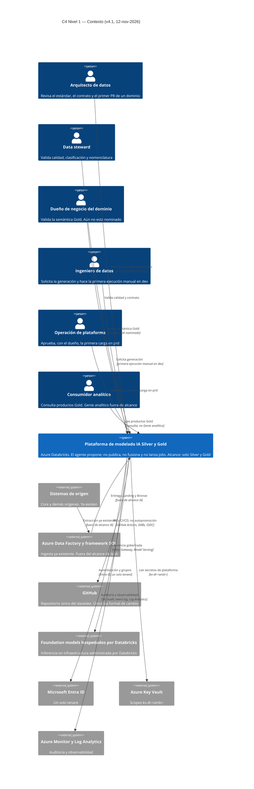
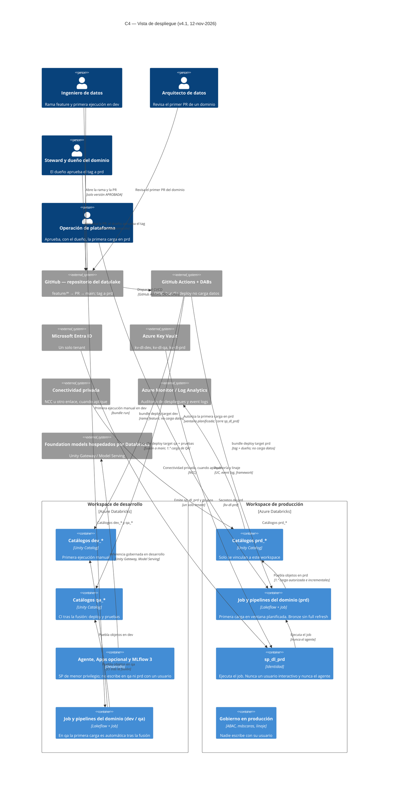

# Diagramas C4 — Modelado IA de Silver y Gold en Azure Databricks

**Versión:** 4.1  
**Fecha:** 12-nov-2026 (America/Guayaquil)  
**Fuente:** Propuesta de arquitectura v4.1  
**Alcance:** solo el modelado de Silver y Gold. El banco no se nombra en este documento.

Este complemento describe la arquitectura objetivo en Azure Databricks. No describe un workspace de prueba. Los archivos editables están en `C4_Solucion_IA_Silver_Gold_v41.drawio` (cinco páginas). Cada vista tiene además una previsualización PNG en este mismo directorio.

El código Mermaid siguiente se puede pegar en un visor local. No requiere abrir enlaces remotos.

---

## Nivel 1 — Contexto del sistema

La plataforma de modelado IA Silver y Gold vive en Azure Databricks y se relaciona con lo que el banco ya opera: los sistemas de origen, Azure Data Factory y el framework SQL (fuera del alcance de la IA), GitHub como única vía formal de cambio, Entra ID, Key Vault y Azure Monitor. La inferencia usa foundation models hospedados por Databricks, invocados de forma gobernada; Azure OpenAI no forma parte del diseño.

El agente es un acelerador de diseño, no un publicador: no fusiona, no despliega y no lanza jobs. Los revisores (arquitecto de datos, data steward, dueño de negocio cuando esté nominado, operación de plataforma) aprueban propuestas y, en prd, la primera carga. El consumidor analítico lee Gold; un canal Genie de consumo queda fuera de alcance.

---

## Nivel 2 — Contenedores

Hay dos ciclos que no deben mezclarse. En desarrollo, el agente (Agent Bricks / Agent Runtime) arma un paquete de contexto (Unity Catalog, framework SQL, Data profiling, MCP con health check), invoca el modelo por Unity Gateway, evalúa en MLflow 3 y deja la propuesta en el catálogo de control (BORRADOR, EN_REVISION, REQUIERE_CAMBIOS, APROBADA). Databricks Apps, si se habilita, y Genie Code asisten; no aprueban ni despliegan.

```mermaid
C4Container
title C4 Nivel 2 — Contenedores (v4.1, 12-nov-2026)

Person(ing, "Ingeniero de datos", "Generación y primera ejecución en dev")
Person(rev, "Arquitecto, steward y dueño", "Revisión humana; el dueño aprueba el tag a prd")

System_Ext(src, "Sistemas de origen", "Fuera del alcance de la IA")
System_Ext(adf, "Azure Data Factory y framework SQL", "Ingesta ya existente")
System_Ext(gh, "GitHub y GitHub Actions", "DABs, OIDC, targets dev / qa / prd")
System_Ext(fm, "Foundation models hospedados por Databricks", "No es Azure OpenAI")
System_Ext(entra, "Microsoft Entra ID", "Un solo tenant")
System_Ext(kv, "Azure Key Vault", "kv-dl-<amb>")
System_Ext(mon, "Azure Monitor / Log Analytics", "Observabilidad")

System_Boundary(adb, "Azure Databricks") {
  Container(apps, "Databricks Apps", "Interfaz opcional", "Asiste el ciclo de generación. No despliega, no aprueba y no lanza jobs")
  Container(genie, "Genie Code", "Asistente del ingeniero", "Ayuda a leer el diff. No sustituye la PR")
  Container(agente, "Agente de modelado", "Agent Bricks / Agent Runtime", "Propone contrato, DDL, Lakeflow y expectations. No fusiona ni lanza el job")
  Container(mcp, "MCP gobernado", "MCP", "Funciones UC y contexto de negocio, con health check")
  Container(gw, "Unity Gateway y Model Serving", "Model Serving", "Acceso gobernado a los foundation models")
  Container(prof, "Data profiling", "Quality monitoring", "Estadísticas y deriva, sin PII en claro")
  Container(mlflow, "MLflow 3", "evaluate / tracing", "Set de evaluación propio del dominio")
  Container(reg, "Registro y bitácora", "Catálogo de control", "Estados BORRADOR, EN_REVISION, REQUIERE_CAMBIOS, APROBADA")
  Container_Ext(land, "Landing", "Ya existe", "Archivos inmutables. Fuera del alcance de la IA")
  Container_Ext(brz, "Bronze", "Ya existe", "Un pipeline por origen, solo append")
  Container(job, "Job pl_dom_<dominio>", "Job de Databricks", "Orquesta el dominio. Serverless. El agente no forma parte de este job")
  Container(slv, "Pipeline Silver", "Lakeflow", "pl_dom_<dominio>_slv. AUTO CDC o FROM SNAPSHOT, SCD1/SCD2, expectations")
  Container(qc, "Tareas de plataforma", "Notebooks", "control_calidad (2 %), aplicar_metadatos y registrar_ejecucion")
  Container(gld, "Pipeline Gold", "Lakeflow", "pl_dom_<dominio>_gld. MVs dim_, fct_, agg_ o dp_. Solo si pasa la calidad")
  Container(uc, "Unity Catalog", "Gobierno", "Un catálogo por capa y ambiente, pendiente de ratificación. Linaje, ABAC, máscaras y etiquetas")
}

Rel(ing, agente, "Solicita una propuesta", "crear o actualizar")
Rel(ing, apps, "Usa la interfaz, si existe", "Databricks Apps")
Rel(rev, reg, "APROBADA o REQUIERE_CAMBIOS", "revisión humana, no el chat")
Rel(apps, agente, "Asiste; no aprueba")
Rel(genie, agente, "Ayuda a leer el diff")
Rel(agente, mcp, "Consulta tras health check", "MCP")
Rel(agente, gw, "Invoca el modelo", "Unity Gateway, Model Serving")
Rel(prof, agente, "Stats agregados, sin PII", "Data profiling")
Rel(agente, mlflow, "Evalúa y traza", "MLflow 3")
Rel(agente, reg, "Registra versión y tokens", "catálogo de control")
Rel(agente, uc, "Lee metadatos y linaje", "SQL parametrizado, service principal")
Rel(reg, gh, "PR solo si APROBADA", "dominios/<dominio>/")
Rel(gw, fm, "Inferencia gobernada", "Model Serving")
Rel(src, adf, "Extracción", "fuera de alcance IA")
Rel(adf, land, "Carga inmutable", "fuera de alcance IA")
Rel(land, brz, "Ingesta ya existente", "solo append")
Rel(brz, job, "Dispara el job", "table trigger o horario diario")
Rel(job, slv, "1. Corre Silver", "Lakeflow serverless")
Rel(slv, qc, "2. control_calidad", "umbral 2 %")
Rel(qc, gld, "3. Gold solo si pasa", "materialized views")
Rel(slv, uc, "Crea o refresca streaming tables")
Rel(gld, uc, "Crea o refresca materialized views", "lee solo Silver")
Rel(qc, uc, "Registra ejecución y conciliación", "<amb>_control")
Rel(gh, job, "bundle deploy (no carga datos)", "DABs, GitHub Actions, OIDC")
Rel(job, entra, "Se autentica con el SP del ambiente", "sp_dl_<amb>")
Rel(kv, uc, "Aporta secretos al scope", "kv-dl-<amb>")
Rel(uc, mon, "Auditoría y event logs", "Unity Catalog, Lakeflow")
```

En operación, un table trigger sobre Bronze o Silver transversal (con horario diario de respaldo) dispara el job `pl_dom_<dominio>`: Silver (Lakeflow) → `control_calidad` → Gold si pasa → `aplicar_metadatos` → `registrar_ejecucion`. `bundle deploy` publica el job y los pipelines, pero no carga datos. Unity Catalog gobierna un catálogo por capa y ambiente, pendiente de ratificación.

---

## Nivel 3 — Componentes del agente de modelado

El orquestador distingue los modos crear y actualizar, y conserva las versiones. Un cliente SQL parametrizado, autenticado con un service principal de menor privilegio, lee Unity Catalog, el framework SQL y el perfilado. El cliente MCP solo llama servidores gobernados después del health check. El ensamblador arma el paquete de contexto sin filas ni PII en claro.

A partir de ese paquete se generan las propuestas Silver (lecturas solo desde Bronze o Silver transversal, SCD1 por defecto, AUTO CDC o FROM SNAPSHOT) y Gold (`dim_`, `fct_`, `agg_`, `dp_`; Gold no lee Bronze). El contrato JSON se valida sin una nueva llamada al modelo; salen también el DDL, el código Lakeflow y `calidad/reglas.yml`. MLflow 3 evalúa un set propio del dominio. El registro queda en el catálogo de control. Solo una versión APROBADA abre la PR. El agente no tiene herramienta para lanzar el job del dominio.

```mermaid
C4Component
title C4 Nivel 3 — Componentes del agente de modelado (v4.1, 12-nov-2026)

Person(ing, "Ingeniero de datos", "Solicita crear o actualizar")
Person(rev, "Revisores humanos", "Arquitecto de datos, data steward y dueño de negocio")

Container_Ext(apps, "Databricks Apps", "Opcional", "No aprueba ni despliega")
Container_Ext(uc, "Unity Catalog", "Metadatos", "Linaje, etiquetas y ABAC")
Container_Ext(fw, "Framework SQL", "Ya existe", "patron_carga, tipo_scd, llaves")
Container_Ext(prof, "Data profiling", "Quality monitoring", "Solo agregados, sin PII")
Container_Ext(mcp, "Servidores MCP gobernados", "MCP", "Funciones UC y contexto de negocio")
System_Ext(std, "Estándar institucional en GitHub", "Nomenclaturas y origen de capas")
Container_Ext(glos, "Glosario de negocio", "Cuando exista", "Entregable del piloto")
Container_Ext(gw, "Unity Gateway y Model Serving", "Model Serving", "Foundation models hospedados por Databricks")
Container_Ext(ctrl, "Catálogo de control", "Registro y bitácora", "No es un almacén paralelo definitivo")
Container_Ext(mlf, "Experimento MLflow 3", "evaluate / tracing", "Vínculo con la PR")
System_Ext(gh, "GitHub — pull request", "Solo versión APROBADA. El agente no fusiona")
Container_Ext(job, "Job pl_dom_<dominio>", "Operación", "El agente no lo lanza")

Container_Boundary(ag, "Agente de modelado — Agent Runtime") {
  Component(orq, "Orquestador del ciclo", "crear / actualizar", "Estados BORRADOR, EN_REVISION, REQUIERE_CAMBIOS, APROBADA")
  Component(sql, "Cliente SQL parametrizado", "Service principal", "sp_dl_<amb> o principal del agente en dev")
  Component(cmcp, "Cliente MCP", "Health check", "Configuración por ambiente")
  Component(ctx, "Ensamblador del paquete de contexto", "Sin PII en claro", "Metadatos, stats, estándar y observaciones")
  Component(gslv, "Generador de propuesta Silver", "Lakeflow", "SCD1 por defecto; señala Data Vault, no lo aplica solo")
  Component(ggld, "Generador de propuesta Gold", "dim_ / fct_ / agg_ / dp_", "Gold no lee Bronze")
  Component(json, "Emisor y validador del contrato JSON", "Contrato versionado", "El CI lo valida sin volver a llamar al modelo")
  Component(art, "Generador de artefactos", "Git", "DDL, Lakeflow, reglas.yml, docs y etiquetas")
  Component(ev, "Evaluador MLflow 3", "evaluate / tracing", "Set propio del dominio")
  Component(reg, "Escritor del registro y de la bitácora", "Catálogo de control", "Propuesta, observaciones, identidad y tokens")
}

Rel(ing, orq, "Solicita crear o actualizar", "Apps opcional o API")
Rel(apps, orq, "Interfaz de asistencia", "no aprueba ni despliega")
Rel(orq, sql, "Pide inventario")
Rel(sql, uc, "Lee metadatos y linaje", "SQL parametrizado, SP")
Rel(sql, fw, "Lee patrón y tipo_scd", "SQL parametrizado, SP")
Rel(sql, prof, "Lee estadísticas", "sin filas ni PII")
Rel(orq, cmcp, "Llama funciones gobernadas")
Rel(cmcp, mcp, "Health check y consulta", "MCP por ambiente")
Rel(std, ctx, "Norma de nombrado y modelado")
Rel(glos, ctx, "Términos y KPIs, cuando existan")
Rel(sql, ctx, "Entrega metadatos y stats")
Rel(cmcp, ctx, "Aporta contexto de negocio")
Rel(ctx, gslv, "Paquete de contexto", "sin PII en claro")
Rel(ctx, ggld, "Mismo paquete, semántica Gold")
Rel(gslv, json, "Entidades Silver y tipo_scd")
Rel(ggld, json, "Entidades Gold y mapeo")
Rel(json, art, "Contrato válido", "esquema validable en CI")
Rel(orq, gw, "Solicita inferencia", "Unity Gateway")
Rel(art, ev, "Artefactos a evaluar", "set propio del dominio")
Rel(ev, reg, "Puntuaciones, traza y tokens", "MLflow 3")
Rel(json, reg, "Alta BORRADOR a EN_REVISION")
Rel(reg, ctrl, "Persiste propuesta y bitácora", "framework SQL")
Rel(ev, mlf, "Registra traza y evaluate", "MLflow 3")
Rel(ctrl, rev, "Queda EN_REVISION")
Rel(rev, ctrl, "APROBADA o REQUIERE_CAMBIOS", "fuera del modelo")
Rel(rev, orq, "Reintento solo de la generación", "id, versión anterior y observaciones")
Rel(ctrl, gh, "PR únicamente si APROBADA", "revisión obligatoria")
```

---

## Nivel 3 — Componentes del pipeline de dominio (operación)

Este tramo empieza después de un `bundle deploy` exitoso, que no inserta filas. La primera ejecución del job crea los objetos en Unity Catalog y hace el backfill desde Bronze (snapshots en orden; un SCD2 no inventa historia fuera de los 7 snapshots retenidos). Las siguientes corridas son incrementales. El cómputo es serverless.

El flujo es `slv` → `control_calidad` (umbral de cuarentena 2 %) → `gld` solo si pasa → `aplicar_metadatos` (idempotente, cuando los objetos ya existen) → `registrar_ejecucion` (siempre, `ALL_DONE`, con conciliación). Si falla la calidad o la conciliación, Gold no se publica y se alerta al dueño. En prd la primera carga la autorizan el dueño y operación, en una ventana planificada, y la ejecuta `sp_dl_prd`. El agente no interviene.

```mermaid
C4Component
title C4 Nivel 3 — Pipeline de dominio, operación (v4.1, 12-nov-2026)

Person(ops, "Operación y dueño del dominio", "Autorizan la primera carga en prd")
Person(ing, "Ingeniero de datos", "Primera ejecución manual en dev")

Container_Ext(brz, "Tablas Bronze", "<amb>_bronze", "Ya pobladas. 7 snapshots en cargas diarias")
Container_Ext(trx, "Silver del dominio transversal", "Única dependencia cruzada", "Si está atrasado, se usa la última versión válida")
Component_Ext(trig, "Disparadores del job", "Orquestación", "Table trigger y horario diario de respaldo")
System_Ext(alert, "Alerta al dueño", "Si falla calidad o conciliación, Gold no se publica")
System_Ext(sp, "Service principal sp_dl_<amb>", "Identidad del job. En prd no corre un usuario interactivo")
Container_Ext(ag, "Agente de modelado", "Fuera de este job", "No interviene y no lo lanza")

Container_Boundary(job, "Job pl_dom_<dominio> — serverless") {
  Component(slv, "Tarea slv", "Lakeflow pl_dom_<dominio>_slv", "AUTO CDC o FROM SNAPSHOT, SCD1/SCD2, expectations. Sin MERGE manual")
  Component(qc, "Tarea control_calidad", "Notebook de plataforma", "Umbral de cuarentena 2 %. Si falla, Gold no se refresca")
  Component(gld, "Tarea gld", "Lakeflow pl_dom_<dominio>_gld", "MVs dim_, fct_, agg_ o dp_. Lee solo Silver")
  Component(meta, "Tarea aplicar_metadatos", "Notebook de plataforma", "Comentarios, etiquetas, máscaras y permisos, idempotente")
  Component(reg, "Tarea registrar_ejecucion", "Notebook de plataforma", "ALL_DONE. Ejecución, conciliación y framework SQL")
}

Container(dslv, "Catálogo Silver", "<amb>_silver", "Creado en la primera ejecución")
Container(dgld, "Catálogo Gold", "<amb>_gold", "No se publica si falla calidad o conciliación")
Container(dctl, "Catálogo de control", "<amb>_control", "calidad.regla, ejecucion y conciliación")

Rel(ops, trig, "Autoriza la primera carga en prd", "ventana planificada")
Rel(ing, slv, "Primera ejecución manual en dev", "tras bundle deploy")
Rel(brz, trig, "Actualización de tablas", "table trigger")
Rel(trx, trig, "Actualización de transversal", "table trigger")
Rel(trig, slv, "Inicia el job", "o horario diario")
Rel(brz, slv, "Lee snapshots o cambios", "AUTO CDC / FROM SNAPSHOT")
Rel(trx, slv, "Lee entidades compartidas", "única dependencia cruzada")
Rel(slv, qc, "Silver materializado", "expectations ya aplicadas")
Rel(qc, gld, "Pasa el umbral de cuarentena", "2 % por defecto")
Rel(qc, alert, "Falla: no refresca Gold", "alerta al dueño")
Rel(slv, meta, "Objetos Silver ya existentes", "idempotente")
Rel(gld, meta, "Objetos Gold ya existentes")
Rel(meta, reg, "Metadatos aplicados")
Rel(qc, reg, "Siempre termina en el registro", "run_if ALL_DONE")
Rel(slv, dslv, "Crea o refresca tablas", "1.ª ejecución = backfill")
Rel(gld, dgld, "Crea o refresca MVs", "solo si pasó calidad")
Rel(reg, dctl, "Ejecución y conciliación", "framework SQL")
Rel(dslv, dgld, "Gold se materializa desde Silver", "origen de capas")
Rel(sp, gld, "Identidad de ejecución del job", "sp_dl_<amb>")
```

---

## Vista de despliegue

El banco tiene dos workspaces (desarrollo y producción) y no tiene workspace de QA. Los catálogos `dev_*` y `qa_*` se vinculan al workspace de desarrollo; los `prd_*`, al de producción. Esa organización, tomada del estándar institucional, está pendiente de ratificación.

GitHub Actions, con DABs y federación OIDC, despliega por target: una rama feature va a `dev` (primera ejecución manual); la fusión a `main` va a `qa` y corre pruebas (primera carga de QA); un tag con aprobación del dueño va a `prd` y no carga datos. La primera carga en prd es un acto distinto, en ventana planificada, ejecutada por `sp_dl_prd`. No hay autopromoción. Las identidades y secretos reutilizan Entra ID (un solo tenant) y Key Vault (`kv-dl-<amb>`).

---

## Archivos

| Archivo | Contenido |
| --- | --- |
| `C4_Solucion_IA_Silver_Gold_v41.drawio` | Cinco páginas editables (app.diagrams.net o draw.io Desktop) |
| `C4_Solucion_IA_Silver_Gold_v41_N1_Contexto.png` | Previsualización del nivel 1 |
| `C4_Solucion_IA_Silver_Gold_v41_N2_Contenedores.png` | Previsualización del nivel 2 |
| `C4_Solucion_IA_Silver_Gold_v41_N3_Agente.png` | Previsualización del nivel 3 del agente |
| `C4_Solucion_IA_Silver_Gold_v41_N3_Pipeline_dominio.png` | Previsualización del nivel 3 del job de dominio |
| `C4_Solucion_IA_Silver_Gold_v41.md` | Este documento, con el código Mermaid de cada vista |

## Supuestos transversales

- Un catálogo por capa y ambiente (`<amb>_landing`, `<amb>_bronze`, `<amb>_silver`, `<amb>_gold`, `<amb>_control`) adopta el estándar institucional y debe ratificarlo arquitectura de datos.
- No hay workspace de QA. El dueño de negocio del piloto (clientes personas naturales) y el glosario de negocio aún no existen.
- El modelo de lenguaje concreto y su disponibilidad en la región de Azure están pendientes. Azure OpenAI no forma parte del diseño.
- OIDC se representa como federación de GitHub Actions hacia Databricks, habitual con DABs; la v4.1 cita Actions y DABs y no detalla esa federación.
- El umbral formal de conciliación, la ventana de la primera carga en prd y de qué Bronze se alimentan los catálogos de QA siguen pendientes.
- No se incluyen identificadores reales de workspace, almacén o job.

